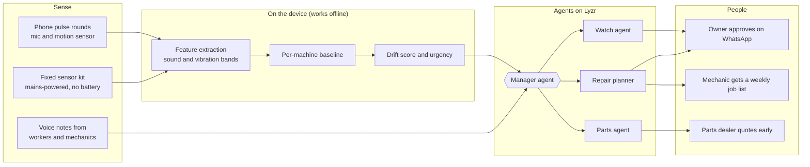

# Machine Vaidya

**A pulse check for every machine.**

Machine Vaidya listens to the old machines in small factories, learns what *normal* sounds like for each one, flags unusual changes early, and helps the owner plan the repair before production stops.

> **Tech4Bharat 2026 (GAVS Hackathon)** · Theme: Industrial Manufacturing · Problem statement 4.3 · Agentic AI
>
> **Status:** idea stage. The prototype is being built in the prototype round (23 Nov – 15 Dec 2026).

---

## The problem

Powerlooms, flour mills, pump sets and small machine shops run old, often second-hand equipment with no condition monitoring and no maintenance team. The owner *is* the maintenance department and judges machine health by sound and feel.

- **Today:** machines run until they fail. Then the owner calls whichever mechanic is free and sends someone to town for the part.
- **What it costs:** lost production days, missed deliveries, emergency prices for parts, and wages paid to idle workers.
- **What makes it hard:** there is no labelled fault data, so anything useful has to learn from weeks of normal running on ageing machines, and keep working offline.

## The solution

| Step | What happens |
|---|---|
| **1. Listen** | A phone held to each machine for 30 seconds a day, or a low-cost fixed sensor, records sound and vibration. |
| **2. Learn normal** | Weeks of normal running teach the system each machine's own "pulse". No fault data is needed. |
| **3. Flag drift** | When sound or vibration drifts from normal and stays drifted, it raises an early warning with an urgency level. |
| **4. Act** | AI agents plan the repair, book the mechanic and check the part. The owner approves with one tap on WhatsApp. |

The owner gets everything on WhatsApp, by voice, in **Kannada or Hindi**. Every decision to stop a machine stays with the owner.

## Architecture

**Signal models do the listening. Language models only explain and plan. Nothing stops a machine without the owner.**

### The agents

| Agent | Job | Guardrail |
|---|---|---|
| **Watch agent** | Decides whether a change is real or noise, combines sensor data with workers' voice notes, and explains it to the owner in Kannada or Hindi. | Never stops a machine. |
| **Repair planner** | Finds an idle window (shift change, planned power cut), books an available mechanic, and protects urgent orders. | The owner approves every plan. |
| **Parts agent** | Asks local spare-part dealers for price and stock *before* the breakdown, so there's no emergency pricing. | Only quotes; the owner orders. |

## How it learns without labelled fault data

- **Its own normal:** each machine is compared only with itself, at the same speed and load.
- **Its neighbours:** in a shed of identical looms, the odd one out shows up from day one.
- **People as data:** workers' voice notes ("loom 7 is knocking") and mechanics' repair notes are linked to the machine's timeline. Over time they become the fault labels that don't exist today, so the system moves from "something changed" to "this looks like a worn bearing".

We report accuracy only after measuring it: first on public machine-sound data ([DCASE 2020 Task 2](https://dcase.community/challenge2020/task-unsupervised-detection-of-anomalous-sounds), [MIMII](https://zenodo.org/record/3384388)), then on our own field recordings.

## Design principles

- **Owner decides.** Agents recommend; only the owner can stop a machine.
- **Offline first.** Scoring runs on the device and syncs when the signal returns.
- **Voice first.** WhatsApp, Kannada and Hindi, no dashboards to learn.
- **Honest claims.** We flag unusual changes that often come before a breakdown. We don't claim to predict failure dates. Simulated faults are labelled.
- **Safe hardware.** Fixed kits are mains-powered with no battery. We never leave old phones charging on machines next to cotton lint.

## Planned tech stack

| Layer | Plan |
|---|---|
| Pulse-round app | Android, on-device feature extraction and baseline scoring |
| Fixed sensor kit | Low-cost microcontroller with a MEMS accelerometer and microphone, mains-powered |
| Models | Unsupervised per-machine baselines, benchmarked on DCASE / MIMII |
| Agents | [Lyzr](https://docs.lyzr.ai/) Manager agent with Watch, Repair planner and Parts agents |
| Messaging | WhatsApp Business Platform |
| Speech | Kannada and Hindi via Bhashini or Sarvam |

## Demo

A table fan with tape on one blade triggers an early warning live. The agent explains it in Kannada and drafts a repair plan, and the owner approves it on WhatsApp. Recordings from real machines show the drift building over time.

## Field validation (before 15 Dec)

We're visiting powerloom units, flour mills and machine shops to answer the brief's six questions:

1. Which machine failed last, how long was it down, and what did it cost?
2. What did workers notice before it failed?
3. How long does it take to find a technician and a part?
4. Are there idle windows when repairs could happen without losing output?
5. What are power and phone signal like on the shop floor?
6. What record of past repairs exists?

**Targets:**

- 10 owners, 10 workers, 5 mechanics and 3 parts dealers.
- Normal-running recordings from at least 5 machines.
- 1–2 pilot units.

## Business model

- **Owners:** a monthly fee per machine, priced well below the cost of one day of downtime. The exact price comes from field data.
- **Mechanics, our channel:** one mechanic serves many small units. They install kits and earn from planned repairs instead of emergency calls.
- **Parts dealers:** referral fees on orders placed through the Parts agent.
- **Later:** equipment makers and dealers, through service data and maintenance contracts.

*Prices and mechanic economics are hypotheses we'll test in the field.*

## Roadmap

| When | Milestone |
|---|---|
| 23 Nov 2026 | Shortlist announced |
| 23–30 Nov | Record machines, run field interviews |
| 1–7 Dec | Baseline models, Watch and Repair agents on Lyzr, Kannada voice |
| 8–15 Dec | Pilot in 1–2 units, measure false alarms and warning lead time |
| 27 Dec 2026 | Grand finale and live demo at Bangalore Palace |

## Team

**[Team name]**

- [Name] · [Role]
- [Name] · [Role]
- [Name] · [Role]
- [Name] · [Role]

## Acknowledgements

Built for [Tech4Bharat](https://hackculture.io/hackathons/tech4bharat-gavs-hackathon), the hackathon of the Global Accelerator Vision Summit 2026, organised by the Karnataka Arya Vysya Mahasabha with RV College of Engineering, JanAI, Lyzr AI and HackCulture.

## License

To be decided, in line with the hackathon's participant IP terms.
